# Moodle lecture recordings

Merlin watches your Moodle courses for new lecture recordings. For each new one it transcribes the audio on your machine (Hebrew-first), writes a summary, and emails it to you. The things students care about come first in the summary: what the lecturer said will be on the exam, what won't be, assignments and deadlines, and points they stressed. Explicit deadlines become Google Tasks.

Moodle has no API or MCP Merlin can use (university SSO, no tokens), so this runs on **browser automation**. Merlin attaches to the same automation Chrome the ops-agent's chrome-devtools MCP uses (CDP on port 9222) and reuses your logged-in session.

## How it works

```mermaid
flowchart LR
    cron["cron */30<br/>trigger-moodle-recordings.sh"] --> run["bin/moodle-recordings run"]
    run -->|CDP :9222| chrome["automation Chrome<br/>(your Moodle session)"]
    chrome --> scan["scan courses + listings<br/>→ new recordings"]
    scan --> sniff["open player, press play,<br/>capture m3u8/mp4/vtt"]
    sniff -->|Hebrew captions| tx
    sniff -->|audio via ffmpeg| whisper["bin/lecture-transcribe<br/>faster-whisper · ivrit-ai"] --> tx["transcript.txt<br/>[hh:mm:ss] lines"]
    tx --> lex["Hebrew keyword pre-scan<br/>lib/lecture-highlights.mjs"] --> claude["claude -p (sonnet)<br/>digest JSON"]
    claude --> html["digest.html (RTL)"]
    html -->|dispatch only when ready| agent["ops-agent<br/>jobs/moodle-recordings.md"]
    agent --> email["email + tasks + 1 phone pointer"]
```



- **Detection.** For each course, the scanner reads `/course/view.php?id=N` and keeps activities that are videos by type (Kaltura `kalvidres`, Zoom, `videofile`, Panopto, Echo360, VideoTime), plus links, files and LTI tools whose name looks like a recording (`הקלטה`, `הרצאה`, `שיעור`, `תרגול`, `recording`, ...). A Zoom activity is opened on its recordings tab, one item per meeting. Galleries that live in iframes (a Panopto folder or Kaltura media gallery behind LTI) are configured as `listings`. All frames are searched for links.
- **First run is silent.** Everything already on Moodle is recorded as `baseline`. Only recordings that appear later are processed. Use `moodle-recordings scan --backfill 2` before the first run to also summarize the last 2 per course.
- **Getting the audio.** The recording page is opened in a background tab and play is pressed. The scanner then records the media and caption URLs the player requests. If Hebrew captions come back (≥30 cues, mostly Hebrew), they are used directly and Whisper is skipped. Otherwise ffmpeg downloads mono 16 kHz audio using the browser's cookies.
- **Transcription** runs on your machine with [faster-whisper](https://github.com/SYSTRAN/faster-whisper) and [ivrit-ai](https://huggingface.co/ivrit-ai)'s Hebrew fine-tune of Whisper large-v3-turbo. Audio never leaves the host. VAD filtering drops long silences (board-writing), which is where Whisper tends to invent text.
- **Highlights.** Hebrew attaches prepositions to words ("במבחן", "שלבחינה", "ולמבחן"). The keyword pre-scan matches each term with an optional prefix and a strict word boundary, so "בחינם" (free) is not read as "בחינה" (exam). It also separates *exclusions* ("לא יהיה במבחן") from inclusions. The model checks these candidate moments against the transcript. If it drops every exam moment, they are added back to the digest marked "auto-detected; verify".
- **Summary** is a one-shot `claude -p --model sonnet`. Lectures longer than about 2 hours are summarized in parts and then merged. The output has a TL;DR, timestamped highlights (type, the lecturer's own words, a note, and a date if one was given), a chronological outline, key concepts and action items.
- **Delivery.** The ops-agent is dispatched only when something is ready. It emails each digest (subject prefixed `[מבחן]` when exam relevance is high), creates Google Tasks for dated exam and assignment mentions, and sends one phone pointer per batch.

## Setup

1. **Automation Chrome.** You need a Chrome running with `--remote-debugging-port=9222` on its own user-data dir. `agent/scripts/chrome-cdp-watch.sh` monitors it. Open Moodle in that Chrome and log in, including SSO, OTP and "remember me".
2. **Dependencies:**
   ```bash
   cd "$MERLIN_HOME/bin" && npm install          # playwright-core
   brew install ffmpeg                          # or apt install ffmpeg
   pip3 install faster-whisper                  # local transcription
   ```
   The first transcription downloads the Whisper model, about 1.6 GB. CPU works: on Apple Silicon or a modern x86, a 90-minute lecture takes roughly 10-30 minutes with `int8`. With an NVIDIA GPU, set `"device": "cuda", "compute_type": "float16"`.
3. **Config.** `cp examples/moodle-config.example.json data/moodle-config.json` and set `base_url`. Leave `auto_discover_courses: true` to pick up every course on your dashboard, or list course ids explicitly (the `id=` in the course URL).
4. **Check it sees your courses:**
   ```bash
   bin/moodle-recordings courses
   bin/moodle-recordings scan          # bootstrap: records existing recordings as baseline
   bin/moodle-recordings list
   ```
5. **Cron:**
   ```
   */30 7-23 * * * $HOME/Dev/merlin/agent/scripts/trigger-moodle-recordings.sh
   ```
6. **Try one end to end:** `bin/moodle-recordings mark <id> new && bin/moodle-recordings process <id>`. Then open `data/moodle-recordings/<id>/digest.html`.

## Configuration reference (`data/moodle-config.json`)

| Key | Default | Meaning |
|---|---|---|
| `base_url` | required | Your Moodle root, e.g. `https://moodle.example.ac.il` |
| `cdp_url` | `http://localhost:9222` | Automation Chrome DevTools endpoint |
| `auto_discover_courses` | on if `courses` empty | Read courses from `/my/courses.php` |
| `courses[]` | `[]` | `{id, name, listings?}`. `listings[]` = `{url, link_selector, settle_ms?}` for galleries |
| `exclude_courses` | `[]` | Course ids to ignore during auto-discovery |
| `recording_modules` | see example | Moodle module types considered at all |
| `name_patterns` | Hebrew + English | Substrings that make a link, file or LTI activity count as a recording |
| `login_url_patterns` | `/login/`, `sso`, `saml`, ... | Redirect targets that mean "session expired" |
| `transcript_language` | `he` | Whisper language; also which captions are accepted |
| `summary_language` | `he` | Language of the digest prose (`he` or `en`). Quotes stay verbatim |
| `prefer_captions` | `true` | Use platform captions when they're Hebrew and substantial |
| `keep_audio` | `false` | Keep `audio.m4a` after transcription |
| `transcribe.model` / `device` / `compute_type` / `python` | ivrit-ai turbo / `auto` / `int8` / `python3` | Passed to `bin/lecture-transcribe` |
| `summarizer.model` / `effort` / `chunk_chars` | `sonnet` / `medium` / `120000` | `claude -p` settings; transcripts longer than `chunk_chars` are split into parts |

## Platform notes

- **Kaltura (`kalvidres`)** and plain **video files** usually work out of the box. Kaltura serves a `playManifest` / HLS playlist.
- **Panopto** usually comes in through an LTI folder. Add the LTI activity's URL as a `listing` with `link_selector: "a[href*='Viewer.aspx?id=']"`. Each session then becomes its own item. If your Panopto has Hebrew auto-captions turned on, they are used.
- **Zoom cloud recordings** come from the Zoom activity's recordings tab. Zoom share links that need a passcode will end up as `no_media`.
- **Unknown players** end up as `no_media`. The ops-agent then opens the page itself with the chrome-devtools MCP and looks for the stream URL. If it finds one, it calls `moodle-recordings set-media <id> <url>` and the next run handles the item. If not, it tells you once.

## Operating it

```bash
bin/moodle-recordings list [--status new,no_media]   # pipeline state
bin/moodle-recordings show <id>                      # paths, errors, attempts
bin/moodle-recordings process <id>                   # run one item now (blocks)
bin/moodle-recordings mark <id> new                  # requeue (e.g. after fixing a dependency)
bin/moodle-recordings digest <id>                    # re-summarize from the existing transcript
tail -f agent/logs/moodle-recordings.log
```

Exit codes: `3` Moodle login needed (a one-shot "log in again" ping is sent), `5` Chrome CDP unreachable (`chrome-cdp-watch` alerts on that), `6` another run in progress.

**Privacy.** Audio and transcription stay on the host. The transcript text is sent to Claude through your own `claude` login for summarizing, the same path every other Merlin agent uses. Nothing goes to other services.
